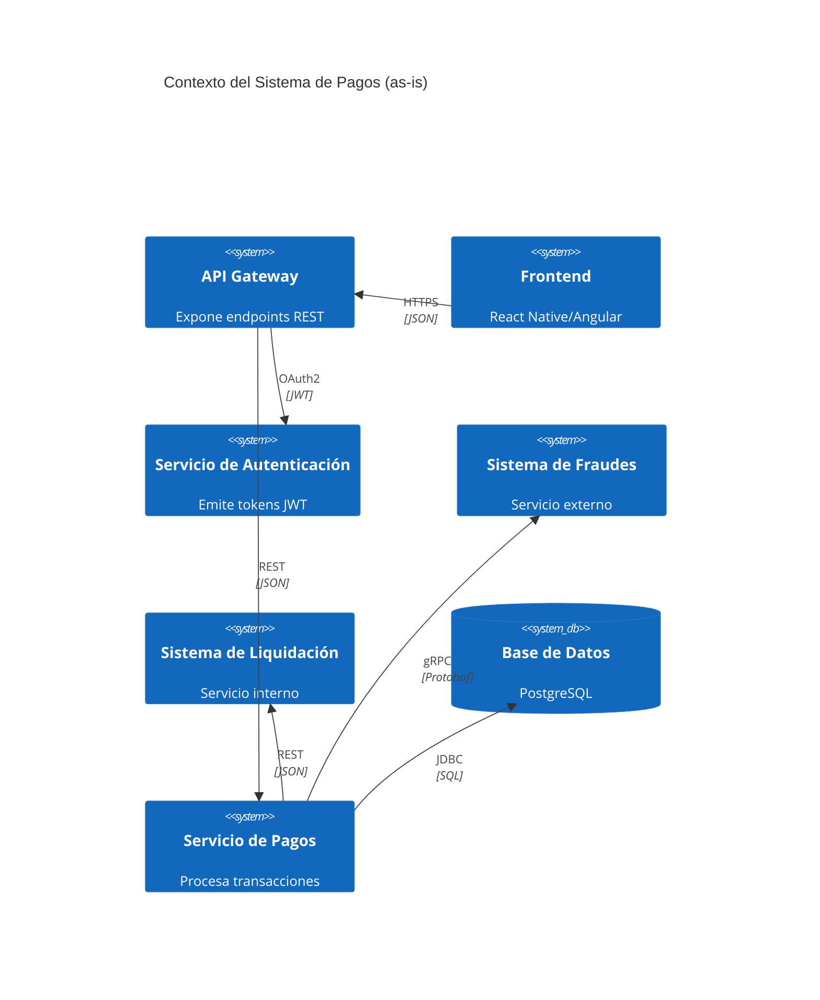

# Arquitectura del Sistema de Pagos

## Vista de Contexto (C4 Model)

> **Preguntas guía para completar el diagrama `diagramas/contexto.mmd`:**
> - ¿Qué actores externos interactúan con la API de pagos?
> - ¿Qué protocolos de comunicación se usan en cada frontera? (ej. REST + JWT, gRPC)
> - ¿Qué datos fluyen entre los actores y la API?

El sistema actual (as-is) opera en un entorno **monolítico** con las siguientes características:

- **Frontend:** Aplicación móvil y web desarrollada en React Native y Angular.
- **API Gateway:** Expone los endpoints de la API de pagos y enruta las peticiones.
- **Servicio de Autenticación:** Emite tokens JWT para autenticar usuarios.
- **Servicio de Pagos:** Procesa transacciones y se comunica con:
  - **Sistema de Fraudes:** Servicio externo para evaluar transacciones sospechosas.
  - **Sistema de Liquidación:** Servicio interno para procesar transferencias interbancarias.
  - **Base de Datos:** Almacena transacciones y saldos.

**Diagrama de contexto actual (as-is):**


## Vista de Contenedores

> **Preguntas guía para completar la vista de contenedores:**
> - ¿Qué contenedores componen el sistema? (ej. API Gateway, Servicio de Pagos, Base de Datos)
> - ¿Qué tecnologías se usan en cada contenedor? (ej. Spring Boot, PostgreSQL)
> - ¿Cómo se comunican los contenedores? (ej. REST, gRPC, mensajería)
> - ¿Qué medidas de seguridad se implementan en cada frontera? (ej. TLS, JWT, WAF)

El sistema actual está compuesto por los siguientes contenedores:

| Contenedor            | Tecnología          | Responsabilidad                                                                 | Protocolos de Comunicación               |
|----------------------|---------------------|---------------------------------------------------------------------------------|------------------------------------------|
| API Gateway          | Kong                | Enrutamiento de peticiones, rate limiting, autenticación básica                | HTTPS, REST                              |
| Servicio de Autenticación | Spring Boot      | Emisión y validación de tokens JWT                                              | OAuth2, JWT                              |
| Servicio de Pagos    | Spring Boot         | Lógica de negocio para procesar transacciones                                  | REST, gRPC, JDBC                         |
| Sistema de Fraudes   | Python (FastAPI)    | Evaluación de transacciones sospechosas                                        | gRPC                                     |
| Sistema de Liquidación | Java (Quarkus)   | Procesamiento de transferencias interbancarias                                  | REST                                     |
| Base de Datos        | PostgreSQL          | Almacenamiento de transacciones y saldos                                        | JDBC                                     |

**Diagrama de contenedores actual (as-is):**
```mermaid
C4Container
    title Contenedores del Sistema de Pagos (as-is)
    Container(api, "API Gateway", "Kong", "Enruta peticiones")
    Container(auth, "Servicio de Autenticación", "Spring Boot", "Emite tokens JWT")
    Container(pagos, "Servicio de Pagos", "Spring Boot", "Procesa transacciones")
    Container(fraudes, "Sistema de Fraudes", "Python (FastAPI)", "Evalúa transacciones")
    Container(liquidacion, "Sistema de Liquidación", "Java (Quarkus)", "Procesa transferencias")
    ContainerDb(db, "Base de Datos", "PostgreSQL", "Almacena datos")

    Rel(frontend, api, "HTTPS", "JSON")
    Rel(api, auth, "OAuth2", "JWT")
    Rel(api, pagos, "REST", "JSON")
    Rel(pagos, fraudes, "gRPC", "Protobuf")
    Rel(pagos, liquidacion, "REST", "JSON")
    Rel(pagos, db, "JDBC", "SQL")
```

## Flujos Críticos de Seguridad

### Flujo de Autenticación
1. El frontend envía credenciales al **Servicio de Autenticación**.
2. El servicio valida las credenciales y emite un **token JWT** con claims (ej. `user_id`, `roles`).
3. El frontend incluye el token en las peticiones a la **API Gateway**.
4. La **API Gateway** valida el token y enruta la petición al **Servicio de Pagos**.

> **Preguntas guía para mejorar el flujo:**
> - ¿Qué medidas adicionales se pueden implementar para prevenir ataques de **suplantación**?
> - ¿Cómo se maneja la **expiración de tokens** para transacciones de larga duración?

### Flujo de Transferencias
1. El frontend envía una petición `POST /transfers` con el token JWT y los datos de la transferencia.
2. El **Servicio de Pagos** valida:
   - La firma del token.
   - El saldo disponible.
   - La integridad de los datos.
3. El servicio envía la transacción al **Sistema de Fraudes** para evaluación.
4. Si la transacción es aprobada, se actualiza la base de datos y se notifica al **Sistema de Liquidación**.

> **Preguntas guía para mejorar el flujo:**
> - ¿Qué tácticas se pueden usar para prevenir **alteración** de datos en tránsito?
> - ¿Cómo se garantiza el **no repudio** de las transacciones?
> - ¿Qué medidas se implementan para mitigar **denegación de servicio**?

## Sistema Propuesto (to-be)

> **Preguntas guía para definir el sistema to-be:**
> - ¿Qué componentes se añaden o modifican para mitigar las amenazas STRIDE?
> - ¿Qué patrones de seguridad se implementan? (ej. WAF, cifrado, firmas digitales)
> - ¿Cómo se distribuyen las responsabilidades de seguridad entre los contenedores?
> - ¿Qué métricas se usan para validar el cumplimiento de los ASRs?

**Cambios propuestos para el sistema to-be:**
1. **API Gateway:**
   - Implementar **WAF (Web Application Firewall)** para filtrar ataques OWASP Top 10.
   - Añadir **rate limiting** por IP y usuario.

2. **Servicio de Autenticación:**
   - Implementar **MFA (Autenticación Multifactor)** para transacciones sensibles.
   - Rotar claves de firma JWT cada **24 horas**.

3. **Servicio de Pagos:**
   - Cifrar datos sensibles en reposo con **AES-256**.
   - Firmar digitalmente las transacciones para garantizar integridad.
   - Implementar **idempotencia** para evitar duplicados.

4. **Base de Datos:**
   - Encriptar columnas sensibles (ej. números de cuenta, montos).
   - Implementar **auditoría de cambios** para detectar alteraciones.

5. **Monitoreo y Respuesta:**
   - Implementar **SIEM (Security Information and Event Management)** para correlacionar eventos.
   - Definir **runbooks** para incidentes de seguridad.